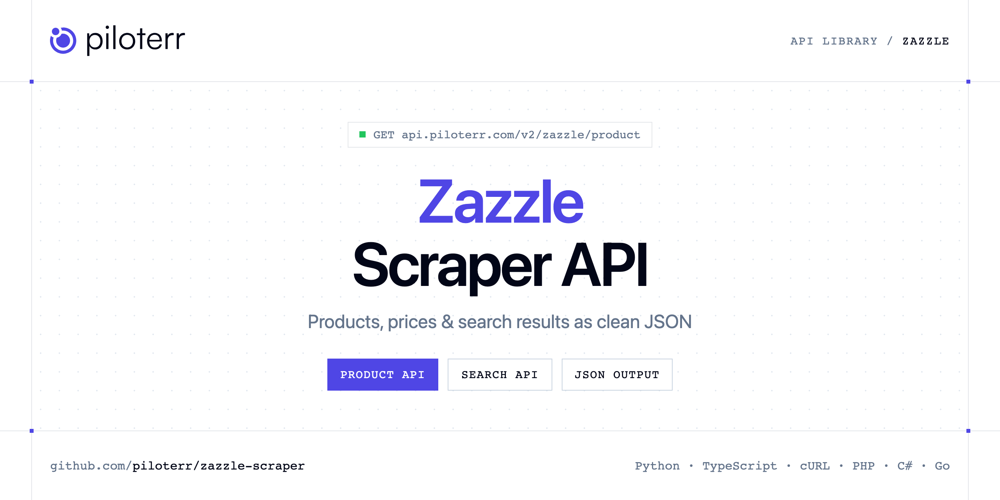

<p align="center">
  <a href="https://www.piloterr.com"></a>
</p>

# Zazzle Scraper API

[](https://discord.gg/CFj3ph8aHU) [](https://app.piloterr.com) [](https://app.piloterr.com/openapi) [](LICENSE)

The **Piloterr Zazzle Scraper API** lets you extract public data from Zazzle as **clean, structured JSON** — no proxies, headless browsers or HTML parsing to maintain. Endpoints available in production:

- **Zazzle Product API** — Fetch one Zazzle product by its product URL or by a slug that ends in the numeric product id.
- **Zazzle Search API** — Search Zazzle products by keyword.

Use it for price monitoring, assortment tracking, competitor analysis, product research or catalog enrichment.

| Endpoint | Path | Credits | What you get |
|---|---|---|---|
| [Zazzle Product API](#zazzle-product-api) | `/v2/zazzle/product` | 2 | Fetch one Zazzle product by its product URL or by a slug that ends in the numeric product id. |
| [Zazzle Search API](#zazzle-search-api) | `/v2/zazzle/search` | 1 | Search Zazzle products by keyword. page maps to the pg parameter. Prices are a number plus a display string. |

## Table of contents

- [How it works](#how-it-works)
- [Zazzle Product API](#zazzle-product-api)
- [Zazzle Search API](#zazzle-search-api)
- [Code examples in other languages](#code-examples-in-other-languages)
- [Practical use cases](#practical-use-cases)
- [Why Piloterr?](#why-piloterr)
- [FAQ](#faq)
- [Related scrapers](#related-scrapers)
- [Support](#support)

## How it works

1. **Create a free Piloterr account** and copy your API key from the [dashboard](https://app.piloterr.com).
2. **Send a `GET` (or `POST`) request** to `https://api.piloterr.com/v2/...` with the header `x-api-key: YOUR_API_KEY`.
3. **Receive structured JSON** — Piloterr handles rendering, proxies, retries and parsing.

```bash
export PILOTERR_API_KEY="your-api-key"
pip install requests        # Python
# TypeScript: Node.js 18+ (native fetch), run with `npx tsx file.ts`
```

> Every endpoint accepts both `GET` (query string) and `POST` (JSON body with the same fields).

## Zazzle Product API

Fetch one Zazzle product by its product URL or by a slug that ends in the numeric product id.

`GET | POST https://api.piloterr.com/v2/zazzle/product` · **2 credits per request** · [Full reference](https://app.piloterr.com/openapi)

### Request parameters

| Parameter | Type | Required | Description |
|---|---|---|---|
| `query` | string | ✅ | Required. Product URL or slug ending in the numeric product id. Example: https://www.zazzle.com/branded_logo_two_tone_coffee_mug-256528848440338952. |

### Python example

```python
import json
import os
import requests

response = requests.get(
    "https://api.piloterr.com/v2/zazzle/product",
    headers={"x-api-key": os.environ["PILOTERR_API_KEY"]},
    params={
        "query": "https://www.zazzle.com/branded_logo_two_tone_coffee_mug-256528848440338952.",
    },
    timeout=60,
)
response.raise_for_status()
data = response.json()

print(json.dumps(data, indent=2, ensure_ascii=False)[:2000])
```

### TypeScript example

```typescript
type ZazzleProduct = {
  url?: string;
  brand?: string;
  image?: string;
  price?: number;
  title?: string;
  currency?: string;
  product_id?: string;
  description?: string;
  availability?: unknown;
  price_display?: string;
};

const params = new URLSearchParams({
  "query": "https://www.zazzle.com/branded_logo_two_tone_coffee_mug-256528848440338952.",
});

const response = await fetch(`https://api.piloterr.com/v2/zazzle/product?${params}`, {
  headers: { "x-api-key": process.env.PILOTERR_API_KEY! },
});
if (!response.ok) throw new Error(`Piloterr error ${response.status}: ${await response.text()}`);

const data = (await response.json()) as ZazzleProduct;

console.log(JSON.stringify(data, null, 2).slice(0, 2000));
```

<details>
<summary><b>POST variant</b></summary>

```http
POST https://api.piloterr.com/v2/zazzle/product
x-api-key: YOUR_API_KEY
Content-Type: application/json

{"query": "https://www.zazzle.com/branded_logo_two_tone_coffee_mug-256528848440338952."}
```
</details>

### Output example

Example response from the API reference, abridged — real values depend on the page you scrape.

```json
{
  "url": "https://www.zazzle.com/branded_logo_two_tone_coffee_mug-256528848440338952",
  "brand": "studioZ",
  "image": "https://rlv.zcache.com/svc/view?max_dim=1000&realview=117426885324810002",
  "price": 15.81,
  "title": "Branded Logo Two-Tone Coffee Mug",
  "currency": "USD",
  "product_id": "256528848440338952",
  "description": "Looking for custom mugs? This mug fits the bill. Personalize it with your own logo for a look that's completely yours. Great for everyday…",
  "availability": null,
  "price_display": "$15.81"
}
```

### Response fields

| Field | Type | Description |
|---|---|---|
| `url` | string |  |
| `brand` | string |  |
| `image` | string |  |
| `price` | number |  |
| `title` | string |  |
| `currency` | string |  |
| `product_id` | string |  |
| `description` | string |  |
| `availability` | object |  |
| `price_display` | string |  |

## Zazzle Search API

Search Zazzle products by keyword. page maps to the pg parameter. Prices are a number plus a display string.

`GET | POST https://api.piloterr.com/v2/zazzle/search` · **1 credit per request** · [Full reference](https://app.piloterr.com/openapi)

### Request parameters

| Parameter | Type | Required | Description |
|---|---|---|---|
| `query` | string | ✅ | Required. Keyword or a zazzle.com/s search URL. Example: coffee mug. A product URL returns 400. |
| `page` | number | — | Optional. Page number from 1. Example: 2. Maps to the Zazzle pg parameter. Defaults to 1. |

### Python example

```python
import json
import os
import requests

response = requests.get(
    "https://api.piloterr.com/v2/zazzle/search",
    headers={"x-api-key": os.environ["PILOTERR_API_KEY"]},
    params={
        "query": "coffee mug. A product URL returns 400.",
    },
    timeout=60,
)
response.raise_for_status()
data = response.json()

print(json.dumps(data, indent=2, ensure_ascii=False)[:2000])
```

### TypeScript example

```typescript
type ZazzleSearch = {
  results?: {
    url?: string;
    image?: string;
    price?: number;
    title?: string;
    product_id?: string;
    price_display?: string;
    original_price?: number;
    original_price_display?: string;
  }[];
  pagination?: {
    next?: string;
    page?: number;
    per_page?: number;
    total_pages?: number;
    total_results?: number;
  };
};

const params = new URLSearchParams({
  "query": "coffee mug. A product URL returns 400.",
});

const response = await fetch(`https://api.piloterr.com/v2/zazzle/search?${params}`, {
  headers: { "x-api-key": process.env.PILOTERR_API_KEY! },
});
if (!response.ok) throw new Error(`Piloterr error ${response.status}: ${await response.text()}`);

const data = (await response.json()) as ZazzleSearch;

console.log(JSON.stringify(data, null, 2).slice(0, 2000));
```

<details>
<summary><b>POST variant</b></summary>

```http
POST https://api.piloterr.com/v2/zazzle/search
x-api-key: YOUR_API_KEY
Content-Type: application/json

{"query": "coffee mug. A product URL returns 400."}
```
</details>

### Output example

Example response from the API reference, abridged — real values depend on the page you scrape.

```json
{
  "results": [
    {
      "url": "https://www.zazzle.com/branded_logo_two_tone_coffee_mug-256528848440338952",
      "image": "https://rlv.zcache.com/branded_logo_two_tone_coffee_mug-r_k6fu4x_306.jpg",
      "price": 15.81,
      "title": "Branded Logo Two-Tone Coffee Mug",
      "product_id": "256528848440338952",
      "price_display": "$15.81",
      "original_price": 18.6,
      "original_price_display": "$18.60"
    }
  ],
  "pagination": {
    "next": "https://www.zazzle.com/s/coffee+mug?pg=2",
    "page": 1,
    "per_page": 60,
    "total_pages": 44398,
    "total_results": 2663878
  }
}
```

### Response fields

| Field | Type | Description |
|---|---|---|
| `results[]` | object[] |  |
| `results[].url` | string |  |
| `results[].image` | string |  |
| `results[].price` | number |  |
| `results[].title` | string |  |
| `results[].product_id` | string |  |
| `results[].price_display` | string |  |
| `results[].original_price` | number |  |
| `results[].original_price_display` | string |  |
| `pagination` | object |  |
| `pagination.next` | string |  |
| `pagination.page` | integer |  |
| `pagination.per_page` | integer |  |
| `pagination.total_pages` | integer |  |
| `pagination.total_results` | integer |  |

## Code examples in other languages

Ready-to-run examples live in the [`examples/`](examples) folder. Each one reads your key from the `PILOTERR_API_KEY` environment variable.

| Language | Product | Search |
|---|---|---|
| cURL (Bash) | [`product`](examples/curl/product.sh) | [`search`](examples/curl/search.sh) |
| PHP | [`product`](examples/php/product.php) | [`search`](examples/php/search.php) |
| C# | [`product`](examples/csharp/Product.cs) | [`search`](examples/csharp/Search.cs) |
| Go | [`product`](examples/go/product.go) | [`search`](examples/go/search.go) |
| Java | [`product`](examples/java/ProductExample.java) | [`search`](examples/java/SearchExample.java) |
| Ruby | [`product`](examples/ruby/product.rb) | [`search`](examples/ruby/search.rb) |
| Node.js | [`product`](examples/nodejs/product.mjs) | [`search`](examples/nodejs/search.mjs) |

## Practical use cases

- **Price monitoring** — Track prices, promotions and availability over time to react to competitors.
- **Assortment & catalog tracking** — Follow new products, delisted items and category changes.
- **Competitor analysis** — Benchmark ranges, brands and positioning across retailers.
- **Product research** — Spot best-sellers and trends from search results.
- **Catalog enrichment** — Pull titles, images and attributes into your PIM or marketplace listings.

## Why Piloterr?

- **No infrastructure** — no proxies, headless browsers or CAPTCHA solving to run yourself.
- **Structured JSON** — stable, documented fields instead of brittle HTML selectors.
- **Pay per request** — transparent credit cost per endpoint, failed requests are retried for you.
- **One API key, hundreds of sources** — Zazzle plus many other e-commerce, search and company data endpoints in the [Piloterr library](https://www.piloterr.com/library).
- **Any language** — plain HTTPS + JSON, with examples for Python, TypeScript, cURL, PHP, C#, Go, Java, Ruby and Node.js.

## FAQ

### Is it legal to scrape Zazzle?

Collecting publicly available data is generally allowed in many jurisdictions, but rules depend on your country, the data you collect and how you use it. Avoid personal data unless you have a lawful basis, respect the website's terms where they apply, and get legal advice for your specific use case. This is not legal advice.

### Do I need proxies or a headless browser?

No. Piloterr handles rendering, proxy rotation and retries on its side. You only send an HTTPS request with your `x-api-key` header and receive JSON.

### How much does a request cost?

Credits per call: `/v2/zazzle/product` **2**, `/v2/zazzle/search` **1**. See the [Piloterr website](https://www.piloterr.com) for plans.

### What data does the Zazzle API return?

Each endpoint returns structured JSON: **Zazzle Product** — `url`, `brand`, `image`, `price`, `title`, `currency`; **Zazzle Search** — `results[]`, `results[].url`, `results[].image`, `results[].price`, `results[].title`, `results[].product_id`.

### How do I paginate Zazzle results?

Use the `page` parameter and keep requesting while the response indicates more results.

### Which languages are supported?

Any language that can make an HTTP request. This README shows Python and TypeScript; the [`examples/`](examples) folder contains cURL, PHP, C#, Go, Java, Ruby and Node.js.

## Related scrapers

- [About You Scraper API](https://github.com/piloterr/aboutyou-scraper)
- [Action Scraper API](https://github.com/piloterr/action-scraper)
- [Aldi Scraper API](https://github.com/piloterr/aldi-scraper)
- [Alibaba Scraper API](https://github.com/piloterr/alibaba-scraper)
- [AliExpress Scraper API](https://github.com/piloterr/aliexpress-scraper)
- [Allegro Scraper API](https://github.com/piloterr/allegro-scraper)
- [All Piloterr scrapers on GitHub](https://github.com/piloterr)

## Support

- 💬 Join the [Piloterr Discord](https://discord.gg/CFj3ph8aHU) to ask questions and share what you build.
- 📚 Browse the [API reference (OpenAPI)](https://app.piloterr.com/openapi) and the [Piloterr library](https://www.piloterr.com/library).
- 🔑 [Get your API key](https://app.piloterr.com).

---

<p align="center">
  <a href="https://www.piloterr.com">
    <picture>
      <source media="(prefers-color-scheme: dark)" srcset="images/logo-dark.svg">
      
    </picture>
  </a>
  <br>
  <sub>Built by <a href="https://www.piloterr.com">Piloterr</a> — web scraping APIs for e-commerce, search, real estate and more, one API key.</sub>
</p>

<sub>Zazzle is a trademark of its respective owner. This repository is not affiliated with or endorsed by Zazzle. Examples are released under the MIT license.</sub>
